  

## 🧭 Mon parcours

C'est au lycée, entre les **mathématiques** et la **NSI**, que j'ai écrit mes premières lignes de code. J'ai ensuite choisi la **licence MIASHS** à Toulouse pour réunir ce qui m'attire : l'informatique, les mathématiques et l'humain derrière les données.

À l'université, j'apprends à **construire** : des bases de données, des applications web, des outils qui remplacent des tâches répétitives. Fin 2025, je fais mes premiers pas en entreprise chez **Web-atrio** : du code en production, des revues de code avec un développeur senior, de vraies contraintes.

En 2026, je me tourne vers l'**intelligence artificielle** : reconnaissance de la langue des signes, prédiction de résultats scolaires, puis **CertiDoc AI**, une base documentaire de certification d'hélicoptères qu'on interroge en langage naturel. Mon fil conducteur ne change pas : **partir de données brutes pour en faire un outil utile et fiable.**

**Prochaine étape :** un **stage de 3 à 6 mois dès février ou avril 2027** pour valider ma licence, puis une **alternance en Data / IA / Développement** pendant mon master.

---

## ⭐ Projet phare : [CertiDoc AI](https://github.com/japhetkoyakossoesso-eng/certidocAI)

> **Base documentaire de certification d'hélicoptères, interrogeable par IA.**
> Mapping de **39 consignes de navigabilité** publiques vers une base SQL, recherche sémantique (**RAG**), réponses et **synthèses par appareil et par pièce** avec citation systématique des sources, schéma interactif de l'appareil, interface **bilingue FR / EN**, modèle de langage **100 % local**.

  

**Stack :** Python · SQLite · LangChain · Chroma · Hugging Face (embeddings multilingues) · Ollama (Llama 3.1) · Flask · HTML / CSS / JavaScript

---

## 🛠️ Compétences

**Langages**

**Data, machine learning & IA**

**Web & applications**

**Bases de données**

**Conception & méthodes**

**DevOps, outils & environnements**

**Développement assisté par IA**

---

## 🚀 Projets

### 🤖 Intelligence artificielle & data

| Projet | Description | Stack |
|---|---|---|
| ⭐ [**CertiDoc AI**](https://github.com/japhetkoyakossoesso-eng/certidocAI) *(2026)* | Base documentaire de certification d'hélicoptères interrogeable par IA : mapping SQL, RAG, synthèses par appareil et par pièce, sources citées, interface bilingue | Python · SQLite · LangChain · Chroma · Ollama · Flask |
| **AI Career Coach** *(2026 – 2027)* | Projet tutoré de L3 en équipe : application d'accompagnement à la recherche d'emploi par IA générative (analyse de CV et d'offres), sécurité des données, pseudonymisation, tests automatisés | Python · LLM · Docker · Git |
| 🤟 [**Signum HandSpeak**](https://github.com/japhetkoyakossoesso-eng/Projet_Signum_HandSpeak_) *(2026)* | Traduction de la langue des signes française en temps réel : 5 200 échantillons, Random Forest à 100 % de précision, LSTM pour les gestes dynamiques, synthèse vocale, export PDF | Python · OpenCV · MediaPipe · scikit-learn · TensorFlow |
| 📊 [**Student Grade Prediction**](https://github.com/japhetkoyakossoesso-eng/projet_prediction_notes_avec_machine_learning) *(2026)* | Pipeline ML complet : dataset synthétique, EDA (8 visualisations), Random Forest et régression logistique, interprétabilité, rapport RMarkdown | Python · scikit-learn · Pandas · R |
| 🌿 [**Qualité de l'air en Occitanie**](https://github.com/japhetkoyakossoesso-eng/Projet_Qualit-_de_l_Air_En_Occitanie) *(2025 – 2026)* | Pipeline ETL, base normalisée (5 tables liées par code INSEE), 15 requêtes SQL sur 5 problématiques, rapport RMarkdown · **noté 18,83/20** | Python · SQLite · PostgreSQL · SQL · R |
| 🧠 [**Initiation à l'IA**](https://github.com/japhetkoyakossoesso-eng/Initiation_A_Lapprentissage_automatique) *(2025 – 2026)* | Analyse comparative de LLM (ChatGPT, DeepSeek, Mistral), base de connaissances en Prolog, benchmark de modèles (impact énergétique, modèles frugaux) | Prolog · Python · IA générative |

### 🌐 Web

| Projet | Description | Stack |
|---|---|---|
| 🧠 [**Quiz John von Neumann**](https://github.com/japhetkoyakossoesso-eng/ProjetWeb-quiz-sur-un-c-l-bre) · [démo](https://projetwebquizsuruncelebrate.vercel.app) *(2025 – 2026)* | Site responsive de 4 pages et quiz interactif de 10 questions (scoring, feedback, validation), validé W3C, testé sur 4 navigateurs, déployé sur Vercel | HTML5 · CSS3 · JavaScript ES6+ · Bootstrap 5.3 |
| 🍕 [**Pizza Django**](https://github.com/japhetkoyakossoesso-eng/Pizza_Django) *(2026)* | Application web de gestion d'une pizzeria (architecture MVT), déployée sur PythonAnywhere | Python · Django · HTML · CSS |
| 🎬 [**Du Python au PHP**](https://github.com/japhetkoyakossoesso-eng/Du_python_au_PHP) *(2026)* | Cinémathèque web : requêtes SQL avec jointures, filtres par genre, ajout et suppression de films | PHP · MariaDB · HTML · CSS |
| 📈 [**Visualisation Chart.js**](https://github.com/japhetkoyakossoesso-eng/developpement_app_web_biblio_chart) *(2025 – 2026)* | Tableaux de bord des inscriptions étudiantes à partir de l'API OpenData du ministère de l'Enseignement supérieur | JavaScript · Chart.js · API REST |
| 🚌 [**Tisséo API Web App**](https://github.com/japhetkoyakossoesso-eng/Projet_Qualit-_de_l_Air_En_Occitanie) *(2026)* | Application JavaScript / AJAX interrogeant l'API OpenData Tisséo (lignes et arrêts de Toulouse) | JavaScript · AJAX · Chart.js · API REST |
| 🌱 [**Ma Semaine Verte**](https://github.com/japhetkoyakossoesso-eng/ma_semaine_verte) *(2026)* | Site sur le développement durable et les habitudes éco-responsables | HTML · CSS |
| 🌐 [**Portfolio**](https://github.com/japhetkoyakossoesso-eng/Mon_porfolio) *(2026)* | Portfolio personnel (mise à jour en cours) | HTML · CSS |

### 🖥️ Applications & automatisation

| Projet | Description | Stack |
|---|---|---|
| 🧾 [**Excel Invoice Generator**](https://github.com/japhetkoyakossoesso-eng/Projet_factures_excel) *(2026)* | Automatisation de la facturation : scan de dossier, contrôle de la structure des fichiers Excel, agrégation par client, génération automatique des factures | Python · openpyxl |
| 🍽️ [**Organisation de repas de groupe**](https://github.com/japhetkoyakossoesso-eng/Projet_ingSI_2) *(2025 – 2026)* | Application de saisie et de suivi des contributions d'un repas de promotion · licence Apache 2.0 | Python · Tkinter · UML |
| 🏠 [**DomoHouse System**](https://github.com/japhetkoyakossoesso-eng/Projet_ingSI_2) *(2026)* | Interface domotique : gestion de maisons et de pièces, thème clair / sombre, traitement d'images | Python · Tkinter · Pillow |
| 🌌 [**Projet Galaxy**](https://github.com/japhetkoyakossoesso-eng/Projet_galaxy) *(2026)* | Jeu arcade en pseudo-3D : perspective, difficulté progressive, power-ups, highscore persistant en JSON | Python · Kivy |
| 🕹️ [**Kivy — Le Lab**](https://github.com/japhetkoyakossoesso-eng/projet_kivy_lelab) *(2026)* | Expérimentations d'interfaces graphiques mobiles / desktop | Python · Kivy |
| 🔐 [**Projet Backdoor**](https://github.com/japhetkoyakossoesso-eng/projet_backdoor) *(2026)* | Projet **éducatif** de cybersécurité : communication client / serveur TCP, pour comprendre les mécanismes d'attaque et de défense | Python · sockets |

---

## 💼 Expérience

| Période | Poste | Structure |
|---|---|---|
| Oct. 2025 – déc. 2025 | 💻 **Stagiaire développeur web** | **Web-atrio** (ESN, Toulouse) — fonctionnalités front et back sur une application en production, requêtes SQL (MySQL), correction d'anomalies, revues de code avec un développeur senior |

## 🎓 Formation & certifications

| Période | Formation |
|---|---|
| 2024 – 2027 | **Licence MIASHS, parcours Informatique** — Université Toulouse Jean Jaurès · 2e sur 80 en L2 |
| 2024 | **Baccalauréat scientifique**, mention Bien |
| 2026 | 📜 **Développeur Python — Formation complète** (Udemy, 69,5 h) |
| En cours | 📊 **Power BI** : Power Query, DAX, Power BI Service · préparation de la certification PL-300 |

---

## 📊 GitHub Stats

*« Code · Apprends · Compétis · Recommence »*

