  

## 🧭 Mon parcours

C'est au lycée, entre les **mathématiques** et la **NSI**, que j'ai écrit mes premières lignes de code. J'ai ensuite choisi la **licence MIASHS** à Toulouse pour réunir ce qui m'attire : l'informatique, les mathématiques et l'humain derrière les données.

À l'université, j'apprends à **construire** : des bases de données, des applications web, des outils qui remplacent des tâches répétitives. Fin 2025, je fais mes premiers pas en entreprise chez **Web-atrio** : du code en production, des revues de code avec un développeur senior, de vraies contraintes.

En 2026, je passe à des projets plus ambitieux : de l'**intelligence artificielle** (langue des signes, prédiction de résultats, recherche documentaire par IA) et des **plateformes complètes**, de la base de données jusqu'à l'interface, comme **SafeTransport AI**. Mon fil conducteur ne change pas : **partir de données brutes pour en faire un outil utile et fiable.**

**Prochaine étape :** un **stage de fin d'études de 3 à 6 mois, dès janvier ou avril 2027**, pour valider ma licence, puis un **master en alternance** en data, IA ou développement.

---

## 🔁 Ma façon de travailler

Pas de projet unique pour me résumer : une méthode que je retrouve dans chacun d'eux.

| Étape | Ce que je fais | Où je l'ai fait |
|---|---|---|
| **1. Comprendre le besoin** | J'écoute avant de coder : recueil des besoins, cahier des charges, comparaison des solutions existantes | AI Career Coach · CertiDoc AI |
| **2. Fiabiliser les données** | Règles de qualité, dédoublonnage, imports que l'on peut rejouer sans rien casser | SafeTransport AI · Web-atrio |
| **3. Construire l'outil** | Je choisis la technologie selon le besoin : API, interface web, script d'automatisation | Spring Boot · Vue.js · Django · PHP · Python |
| **4. Vérifier** | Tests de la base de données, tests unitaires, intégration continue : rien n'est livré sans être vérifié | 29 tests SQL sur SafeTransport AI · Repas de groupe |
| **5. Expliquer et transmettre** | Documentation, rapports, tableaux de bord, soutenances | Qualité de l'air (**18,83/20**) · chef de projet sur Ma Semaine Verte |

---

## 🛠️ Compétences

**Langages**

**Back-end & API**

**Front-end & interfaces**

**Data, BI & visualisation**

**Machine learning & IA**

**Bases de données**

**Qualité & tests**

**Conception & méthodes**

**DevOps, outils & environnements**

**Développement assisté par IA**

---

## 🚀 Projets

> 🔒 = dépôt privé, code présenté sur demande.

### 🤖 Data, intelligence artificielle & plateformes

| Projet | Description | Stack |
|---|---|---|
| 🚦 [**SafeTransport AI**](https://github.com/japhetkoyakossoesso-eng/SafeTransportIA) *(2026 – 2027)* | Plateforme d'analyse de la sécurité des transports (route et aviation) : ETL des données d'accidents (ONISR / BAAC, NTSB) avec dédoublonnage et règles de qualité, base PostgreSQL versionnée (27 tables, 29 tests SQL), schéma décisionnel en étoile pour Power BI, API, interface web, back-office et analyses statistiques. Taux 2023 cohérents avec les chiffres officiels | Python · FastAPI · Java · Spring Boot · Vue.js · PHP · Laravel · Node.js · R · PostgreSQL · PostGIS · pgvector · Flyway · Power BI · Docker · GitHub Actions |
| 📄 [**CertiDoc AI**](https://github.com/japhetkoyakossoesso-eng/certidocAI) *(2026)* | Base documentaire de certification d'hélicoptères interrogeable par IA : 39 consignes de navigabilité mappées en SQL, RAG, synthèses par appareil et par pièce avec sources citées, interface bilingue FR / EN, modèle 100 % local | Python · SQLite · LangChain · Chroma · Ollama · Flask |
| 🎯 **AI Career Coach** *(2026 – 2027)* | Projet tutoré de L3 en équipe : accompagnement à la recherche d'emploi par IA générative (analyse de CV et d'offres), sécurité des données, pseudonymisation, tests automatisés | Python · LLM · Docker · Git |
| 🤟 **Signum HandSpeak** 🔒 *(2026)* | Traduction de la langue des signes française en temps réel : 5 200 échantillons, Random Forest à 100 % de précision, LSTM pour les gestes dynamiques, synthèse vocale, export PDF | Python · OpenCV · MediaPipe · scikit-learn · TensorFlow |
| 📊 [**Student Grade Prediction**](https://github.com/japhetkoyakossoesso-eng/projet_prediction_notes_avec_machine_learning) *(2026)* | Pipeline ML complet : dataset synthétique, EDA (8 visualisations), Random Forest et régression logistique, interprétabilité, rapport RMarkdown | Python · scikit-learn · Pandas · R |
| 🌿 **Qualité de l'air en Occitanie** 🔒 *(2025 – 2026)* | Pipeline ETL, base normalisée (5 tables liées par code INSEE), 15 requêtes SQL sur 5 problématiques, rapport RMarkdown et application R Shiny · **noté 18,83/20** | Python · SQL · PostgreSQL · SQLite · R · Shiny |
| 🧠 **Initiation à l'IA** 🔒 *(2025 – 2026)* | Analyse comparative de LLM (ChatGPT, DeepSeek, Mistral), base de connaissances en Prolog, benchmark de modèles (impact énergétique, modèles frugaux) | Prolog · Python · IA générative |

### 🌐 Web

| Projet | Description | Stack |
|---|---|---|
| 🌱 [**Ma Semaine Verte**](https://github.com/japhetkoyakossoesso-eng/ma_semaine_verte) *(2025 – 2026)* | **Chef de projet** d'une équipe de 5 : application qui calcule l'empreinte carbone d'un étudiant à partir de l'API Impact CO2 de l'ADEME, résultats en graphiques | JavaScript · API REST · Chart.js · GitLab |
| 🍕 [**Pizza Django**](https://github.com/japhetkoyakossoesso-eng/Pizza_Django) *(2026)* | Application web de gestion d'une pizzeria (architecture MVT), déployée sur PythonAnywhere | Python · Django · HTML · CSS |
| 🎬 [**Du Python au PHP**](https://github.com/japhetkoyakossoesso-eng/Du_python_au_PHP) *(2026)* | Cinémathèque web : requêtes SQL avec jointures, filtres par genre, ajout et suppression de films | PHP · MariaDB · HTML · CSS |
| 🧠 **Quiz John von Neumann** 🔒 · [démo](https://projetwebquizsuruncelebrate.vercel.app) *(2025 – 2026)* | Site responsive de 4 pages et quiz interactif de 10 questions, validé W3C, testé sur 4 navigateurs, déployé sur Vercel | HTML5 · CSS3 · JavaScript ES6+ · Bootstrap 5.3 |
| 📈 **Visualisation Chart.js** 🔒 *(2025 – 2026)* | Tableaux de bord des inscriptions étudiantes à partir de l'API OpenData du ministère de l'Enseignement supérieur | JavaScript · Chart.js · API REST |
| 🚌 **Tisséo API Web App** *(2026)* | Application JavaScript / AJAX interrogeant l'API OpenData Tisséo (lignes et arrêts de Toulouse) | JavaScript · AJAX · Chart.js · API REST |
| 🌐 [**Portfolio**](https://japhetkoyakossoesso-eng.github.io) · [code](https://github.com/japhetkoyakossoesso-eng/japhetkoyakossoesso-eng.github.io) *(2026)* | Mon site : projets filtrables, méthode de travail interactive, terminal de présentation | HTML · CSS · JavaScript |

### 🖥️ Applications & automatisation

| Projet | Description | Stack |
|---|---|---|
| 🍽️ [**Repas de groupe**](https://github.com/japhetkoyakossoesso-eng/Projet_ingSI_2) *(2025 – 2026)* | En équipe de 3 : suivi des contributions d'un repas de promotion, architecture en couches (contrôleurs, services, repository), base SQLite et **tests unitaires** · licence Apache 2.0 | Python · Tkinter · SQLite · UML |
| 🅿️ [**DreamPark**](https://github.com/japhetkoyakossoesso-eng/Projet_parking) *(2025 – 2026)* | Système de gestion de parking : stationnement, récupération des véhicules, abonnements, statistiques et interface graphique | Python · POO |
| 🧾 **Excel Invoice Generator** 🔒 *(2026)* | Automatisation de la facturation : contrôle de la structure des fichiers Excel, agrégation par client, génération automatique des factures | Python · openpyxl |
| 🏠 **DomoHouse System** *(2026)* | Interface domotique : gestion de maisons et de pièces, thème clair / sombre, traitement d'images | Python · Tkinter · Pillow |
| 🕹️ [**Lab Kivy**](https://github.com/japhetkoyakossoesso-eng/projet_kivy_lelab) *(2026)* | Expérimentations d'interfaces graphiques mobiles et desktop | Python · Kivy · kvlang |
| 🌌 **Projet Galaxy** 🔒 *(2026)* | Jeu arcade en pseudo-3D : perspective, difficulté progressive, power-ups, meilleur score sauvegardé en JSON | Python · Kivy |

---

## 💼 Expérience

| Période | Poste | Structure |
|---|---|---|
| Oct. 2025 – déc. 2025 | 💻 **Stagiaire développeur web** | **Web-atrio** (ESN, Toulouse) — fonctionnalités front et back sur une application en production, requêtes SQL (MySQL), correction d'anomalies, revues de code avec un développeur senior, documentation |

## 🎓 Formation & certifications

| Période | Formation |
|---|---|
| 2024 – 2027 | **Licence MIASHS, parcours Informatique** — Université Toulouse Jean Jaurès |
| 2024 | **Baccalauréat scientifique**, mention Bien |
| 2026 | 📜 **Développeur Python — Formation complète** (Udemy, 69,5 h) |
| En cours | 📊 **Power BI** : Power Query, DAX, Power BI Service · préparation de la certification PL-300 |
| Dès 2027 | 🎯 **Master en alternance** (data, IA, développement) — je recherche une entreprise d'accueil |

---

## 📫 Me contacter

**Stage de fin d'études de 3 à 6 mois, dès janvier ou avril 2027**, puis alternance en master.

[🌐 Portfolio](https://japhetkoyakossoesso-eng.github.io) · [💼 LinkedIn](https://www.linkedin.com/in/japhet-koyakosso-esso-974a33313) · [✉️ japhetkoyakossoesso@gmail.com](mailto:japhetkoyakossoesso@gmail.com)

---

## 📊 GitHub Stats

*« Code · Apprends · Compétis · Recommence »*

